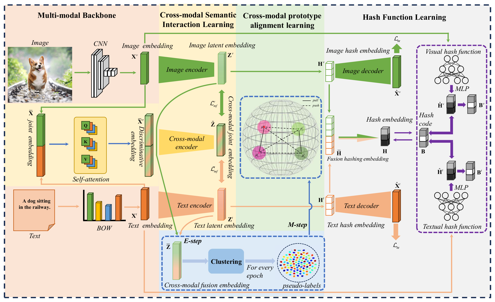

# ACoPSe: Attention-driven contrastive learning for cross-modal hashing with prototypical separation

**Zhipeng He, Wenzhe Liu, Lian Wu, Jinrong Cui, and Jie Wen**  
*Information Fusion*, volume 130, article 104078 (2026). First available online on 25 December 2025. [Publisher record](https://www.sciencedirect.com/science/article/pii/S1566253525011406) · [DOI](https://doi.org/10.1016/j.inffus.2025.104078)

## Abstract and motivation

Cross-modal retrieval ranks text for an image query or images for a text query. Compact binary codes let both directions rank items in a common Hamming space. Images and text describe related content through different feature distributions, and semantic labels can be costly to obtain. ACoPSe uses paired image–text observations to learn cross-modal structure without per-sample semantic labels in the training losses.

## Main contributions

- **Modality-aware fusion.** Self-attention builds a joint representation from paired image and text descriptors. A contrastive loss brings each modality's latent representation closer to the joint embedding of the same pair.
- **Pseudo-labels from paired features.** Cosine K-means clusters the concatenated image and text latents at the start of each epoch. The same pseudo-label follows both members of a pair into prototype learning. This gives the model a cluster-level training signal derived from the features.
- **Prototype alignment and separation.** Each modality contributes a prototype for each occupied cluster in a mini-batch. The paper aligns corresponding image and text prototypes and separates nonmatching prototypes within and across modalities. The released code applies one-way CP1, with an image prototype as the anchor, its matched text prototype as the positive, and other image prototypes as negatives.

## Method overview

[](docs/figures/acopse-overview.png)

*Overview of ACoPSe as described in the paper.* The release launchers start from pre-extracted MAT features.

The release uses two Transformer layers with two attention heads each, a one-way CP1 prototype loss, and feature reconstruction, affinity matching, and quantization losses in the shared-code generator. After each generator epoch, the two modality-specific hash networks are trained jointly on the shared binary targets, with a loss on paired outputs. At evaluation, each network encodes its own modality independently.

The paper specifies four attention heads, bidirectional prototype terms with within- and cross-modality negatives, and sequential training stages in §4.3, Eq. 4, and Algorithm 1. The validation results below apply to the release implementation.

## Repository structure

| Path | Role |
| --- | --- |
| [`main_mir.py`](main_mir.py), [`main_nus.py`](main_nus.py) | Train or evaluate on MIRFlickr-25K and NUS-WIDE. |
| [`configs/`](configs/) | Dataset-specific JSON defaults and CLI overrides. |
| [`load_data.py`](load_data.py) | Reads image, text, and label matrices and returns paired rows with dataset indices. |
| [`models.py`](models.py) | Shared-code generator, attention encoder, and independent image and text hash networks. |
| [`my_opt.py`](my_opt.py), [`torch_clustering/`](torch_clustering/) | Training, losses, checkpoint handling, and vendored PyTorch K-means. |
| [`utils.py`](utils.py) | Hash-code generation, Hamming ranking, MAP, and logging. |
| [`docs/`](docs/), [`tests/`](tests/) | Setup, data, and evaluation guides, plus CLI and checkpoint regression tests. |

The ACoPSe implementation builds on CIRH's data loading, hash networks, and training and retrieval code. It adds attention-based fusion and prototype learning, with K-means from Hzzone's PyTorch implementation. [Third-party provenance and notices](THIRD_PARTY_NOTICES.md)

## Requirements

GPU validation used Windows with Python **3.7.16**, PyTorch **1.13.1+cu117**, torchvision **0.14.1+cu117**, and an NVIDIA **RTX 4090**. The launchers require CUDA. Main dependencies include NumPy, SciPy, h5py, Lightly, and tqdm. [Environment details](docs/environment.md)

## Installation

The commands below create a Windows x64 environment using dependency versions from the tested stack. A clean installation with this recipe remains untested. Use an NVIDIA driver compatible with the CUDA 11.7 build.

```text
conda create -n acopse-repro python=3.7.16 pip=22.3.1
conda activate acopse-repro
python -m pip install torch==1.13.1+cu117 torchvision==0.14.1+cu117 --extra-index-url https://download.pytorch.org/whl/cu117
python -m pip install numpy==1.21.5 scipy==1.7.3 scikit-learn==1.0.2 h5py==3.8.0 matplotlib==3.5.3 tqdm==4.64.1 munkres==1.1.4 lightly==1.4.3 lightly-utils==0.0.2 pytorch-lightning==1.9.5 torchmetrics==0.11.4 pillow==9.4.0
python -m pip check
```

Run the launchers from the repository root. Each one selects its dataset preset automatically. Set `--DATA_DIR`, `--MODEL_DIR`, and `--LOG_DIR` for your workspace. [Dependency and CUDA checks](docs/environment.md) · [PyTorch CUDA 11.7 wheel instructions](https://docs.pytorch.org/get-started/previous-versions/#v1131)

## Dataset preparation

The launchers expect **pre-extracted features in MAT files**. The paper describes 4,096-dimensional AlexNet image features from before the final fully connected layer and bag-of-words text descriptors. The exact extractor recipe, vocabulary, and sample ID manifests are unavailable in this release.

| Dataset | Train / query / retrieval rows | Image / text / label widths |
| --- | --- | --- |
| MIRFlickr-25K | 5,000 / 2,000 / 18,015 | 4,096 / 1,386 / 24 |
| NUS-WIDE | 5,000 / 2,000 / 184,577 | 4,096 / 1,000 / 10 |

LIACS hosts the raw MIRFlickr-25K assets. Current download availability through the original NUS-WIDE project page is unverified. The ACoPSe paper lists its data as available on request. [MIRFlickr download](https://press.liacs.nl/mirflickr/mirdownload.html) · [NUS-WIDE dataset paper](https://doi.org/10.1145/1646396.1646452)

With `--DATA_DIR ./datasets`, place `mir_train.mat`, `mir_query.mat`, and `mir_database.mat` in `datasets/MIRFlickr/`. Place `nus_train.mat`, `nus_query.mat`, and `nus_database.mat` in `datasets/NUS-WIDE/`. Each file contains aligned image, text, and label matrices. The dataset guide covers benchmark sources, preprocessing details, and the expected MAT keys. [Dataset guide](docs/datasets.md)

## Training

```text
python main_mir.py --TRAIN True --DATA_DIR ./datasets --MODEL_DIR ./checkpoints --LOG_DIR ./logs --HASH_BIT 16
python main_nus.py --TRAIN True --DATA_DIR ./datasets --MODEL_DIR ./checkpoints --LOG_DIR ./logs --HASH_BIT 16
```

| Setting | MIRFlickr-25K | NUS-WIDE |
| --- | ---: | ---: |
| `BATCH_SIZE` | 512 | 1,024 |
| `NUM_EPOCH` | 60 | 120 |
| `cluster_num` | 24 | 10 |
| `LR_MyNet` | 0.001 | 0.0001 |
| `LR_IMG`, `LR_TXT` | 0.0001 each | 0.0001 each |

Use `--cluster_num` to set the number of K-means clusters and prototype slots. The separate `--K` setting controls affinity sparsification. Set `--HASH_BIT` for code length, `--SEED` for the Torch and CUDA seed, and `--EVAL_INTERVAL` for the number of epochs between evaluations. The launchers select checkpoints by the sum of both query MAP scores. The table records release defaults. Section 4.3 of the paper lists batch size 1,024 for MIRFlickr-25K.

## Evaluation

```text
python main_mir.py --TRAIN False --DATA_DIR ./datasets --MODEL_DIR ./checkpoints --LOG_DIR ./logs --HASH_BIT 16
python main_nus.py --TRAIN False --DATA_DIR ./datasets --MODEL_DIR ./checkpoints --LOG_DIR ./logs --HASH_BIT 16
```

Use a checkpoint matching the dataset and bit length, named `MIRFlickr_16bits.pth` or `NUSWIDE_16bits.pth` for these examples. Image-to-text ranks database text for image queries. Text-to-image ranks database images for text queries. Both directions report **MAP@5000** using Hamming ranking and shared positive labels for relevance. [Evaluation protocol](docs/evaluation.md)

The release was checked against the original implementation with matched inputs, weights, and pseudo-labels. The tested model outputs, losses, gradients, and fixed-checkpoint retrieval results matched. GPU smoke tests trained for one epoch on the supplied MIRFlickr features and on a synthetic NUS-WIDE-format fixture. Both launchers reproduced their smoke-test scores after reloading the saved checkpoints. Full NUS-WIDE benchmarking and reproduction of the published Table 3 scores remain unverified.

## Citation

```bibtex
@article{he2026acopse,
  title   = {Attention-driven contrastive learning for cross-modal hashing with prototypical separation},
  author  = {He, Zhipeng and Liu, Wenzhe and Wu, Lian and Cui, Jinrong and Wen, Jie},
  journal = {Information Fusion},
  year    = {2026},
  volume  = {130},
  pages   = {104078},
  doi     = {10.1016/j.inffus.2025.104078}
}
```
